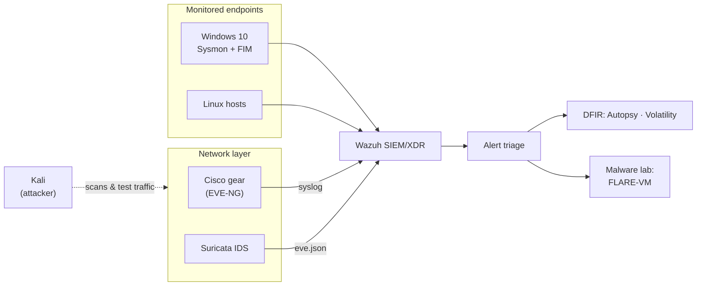

# 👋 Hi, I'm Usama Ahmad 

### 🛡️ BSCS Graduate · SOC Analyst in Training · Digital Forensics & DFIR

---

## 🎯 About me

I build and break things in **home-lab environments** to understand how attacks happen and how defenders catch them: SIEM detection, network intrusion analysis, memory and disk forensics, and malware triage.

Every project below is documented as a **step-by-step tutorial with real screenshots**, including the mistakes I made and how I fixed them, because debugging is where the real learning happens.

**🎯 Target roles:** SOC Analyst · Network Security Analyst · Digital Forensics Analyst, growing toward incident response and threat hunting.

**📜 Certifications:** CEH (in progress) · CHFI (exam passed, certification pending)

---

## 🧪 Projects

Seven labs that follow the path of a real incident: **detect → investigate → analyse → harden**.

| # | Project | What I did | Tools |
|:-:|---|---|---|
| 01 | [**Home SOC & SIEM Lab**](https://github.com/UsamaAhmad360/01-HOME-SOC-SIEM-Lab) | Centralised Windows and Linux telemetry in Wazuh; Sysmon for process/network/registry activity; FIM and custom rules for alert triage | Wazuh · Sysmon · FIM |
| 02 | [**Digital Forensics & Memory**](https://github.com/UsamaAhmad360/02-DFIR-Digital-Forensics-Memory) | Investigated a disk image: recovered deleted/carved files, registry and browser artifacts, evidence reports; memory analysis workflow | Autopsy · Volatility · FTK Imager |
| 03 | [**Malware Analysis Lab**](https://github.com/UsamaAhmad360/03-Malware-Analysis-Lab) | Isolated FLARE-VM + Kali/INetSim lab; static triage of a .NET sample, file-type identification, IOC extraction | FLARE-VM · PEStudio · CFF Explorer |
| 04 | [**Network IDS & Monitoring**](https://github.com/UsamaAhmad360/04-Network-IDS-Monitoring-Lab) | Suricata integrated with Wazuh; custom signatures for scans, ICMP/UDP/Slowloris/DHCP attacks; validated against captures | Suricata · Wazuh · Wireshark |
| 05 | [**Cisco Infrastructure Lab**](https://github.com/UsamaAhmad360/05-Cisco-Infrastructure-Lab) | Multi-device topologies: VLANs, OSPF, RIP, STP/RSTP, EtherChannel, HSRP, ACLs, NAT, DHCP, SSH | Cisco IOS · EVE-NG · Packet Tracer |
| 06 | [**Vulnerability Assessment**](https://github.com/UsamaAhmad360/06-Vulnerability-Assessment-Lab) | Nessus and Nmap scans, authenticated vs unauthenticated comparison, CVE/CVSS research, remediation priorities | Nessus · Nmap · CVE/CVSS |
| 07 | [**DNS & Attack Surface Recon**](https://github.com/UsamaAhmad360/07-DNS-Attack-Surface-Recon-Lab) | DNS enumeration, zone transfers, certificate-transparency subdomain discovery, Shodan exposure search | Shodan · DNSRecon · crt.sh |

### 💡 Highlights

- **Authenticated scans change the picture:** the same kind of Nessus scan went from **5 → 26 critical findings** once it could log in (repo 06).
- **One bad character can silence a SIEM agent:** a UK-keyboard paste corrupted my Wazuh config; I documented the diagnosis and fix (repo 01).
- **Detection needs proof:** every custom Suricata rule is paired with a controlled test from Kali (repo 04).
- **Deleted ≠ gone:** most of the interesting artefacts in my forensics case sat in unallocated space (repo 02).

---

## 🗺️ How the labs fit together

---

## 🔧 Toolkit

| Area | Tools |
|:---|:---|
| **SOC / SIEM** |    |
| **Network security** |    |
| **Digital forensics** |    |
| **Malware analysis** |     |
| **Vulnerability assessment** |   |
| **OSINT / recon** |    |
| **Networking** |    |
| **Scripting** |   |

---

## 🧠 Skills these labs demonstrate

| Skill | Where to see it |
|---|---|
| Alert triage and log correlation | [01 SOC & SIEM](https://github.com/UsamaAhmad360/01-SOC-SIEM-Lab) |
| Detection engineering (writing and testing rules) | [04 Network IDS](https://github.com/UsamaAhmad360/04-Network-IDS-Monitoring) |
| Evidence handling and disk forensics | [02 DFIR](https://github.com/UsamaAhmad360/02-DFIR-Digital-Forensics-Memory) |
| Static malware triage and IOC writing | [03 Malware Lab](https://github.com/UsamaAhmad360/03-Malware-Analysis-Lab) |
| Network design, segmentation and hardening | [05 Cisco Lab](https://github.com/UsamaAhmad360/05-Cisco-Infrastructure-Lab) |
| Vulnerability prioritisation and reporting | [06 Vulnerability Assessment](https://github.com/UsamaAhmad360/06-Vulnerability-Assessment-Lab) |
| Passive recon and attack-surface mapping | [07 DNS & Recon](https://github.com/UsamaAhmad360/07-DNS-Attack-Surface-Recon) |
| Troubleshooting and documentation | Every repo has a troubleshooting section |

---

## 🏗️ What's next

- [ ] Add **Wireshark capture** screenshots and **Wazuh alert** evidence to the IDS and SIEM labs
- [ ] **Dynamic malware analysis** write-ups (Ghidra, x64dbg, FakeNet-NG) with persistence and callback findings
- [ ] Full **Volatility** walkthrough with screenshots on a public memory sample
- [ ] Credentialed **Windows Server** Nessus scan and a full vulnerability report
- [ ] Custom **Wazuh rules and decoders** for Sysmon-based detections (mapped to MITRE ATT&CK)
- [ ] Finish **CEH** and receive the **CHFI** certification
- [ ] Contribute to open-source blue-team tooling

---

## 📫 Let's connect

| | |
|:---|:---|
| **Email** | [mlkusama360@gmail.com](mailto:mlkusama360@gmail.com) |
| **LinkedIn** | [Usama Ahmad](https://www.linkedin.com/in/usama-ahmad-a85401363/) |
| **Portfolio** | [usamaahmad360.github.io/Usama-s-Portfolio](https://usamaahmad360.github.io/Usama-s-Portfolio/) |
| **GitHub** | [@UsamaAhmad360](https://github.com/UsamaAhmad360) |

*Open to entry-level SOC, network security and digital forensics opportunities.*

